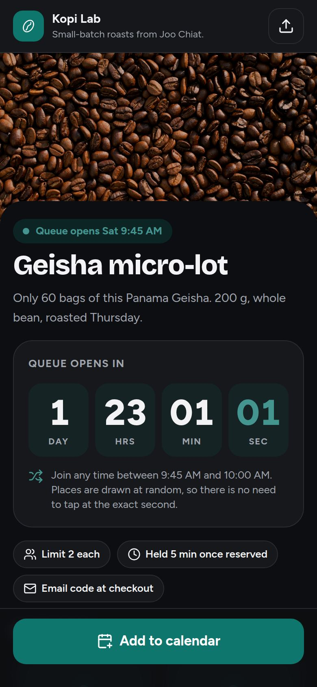
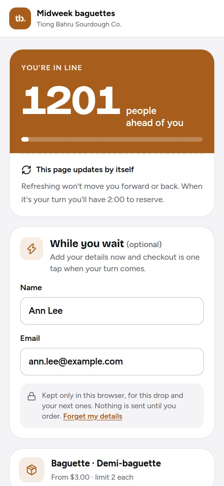
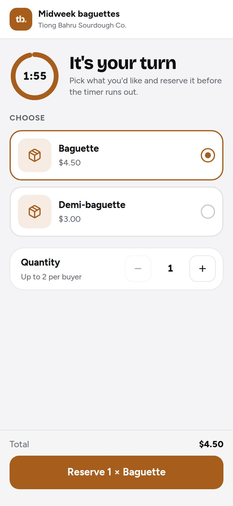
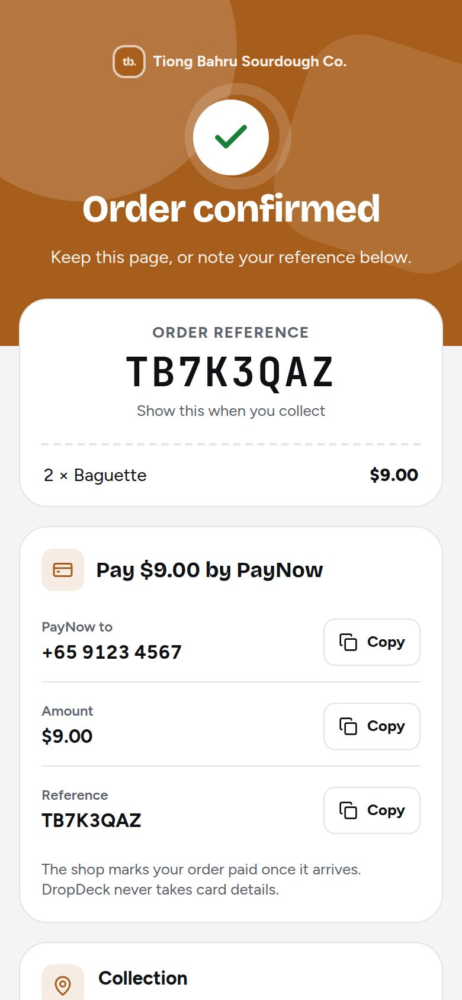
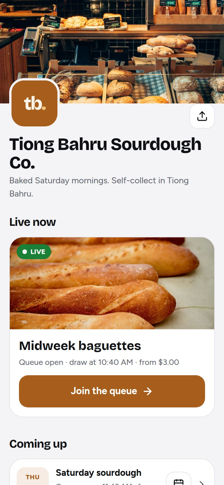
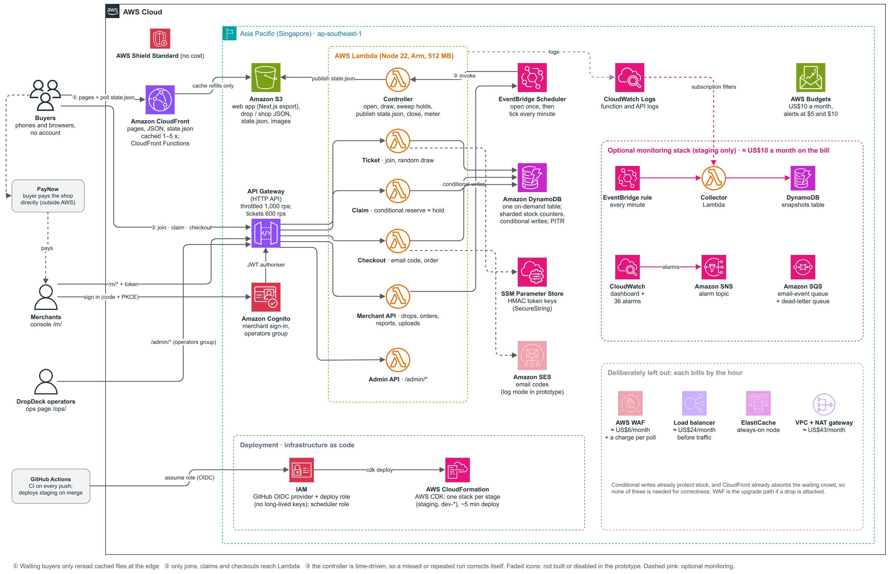

# DropDeck

Hosted drops for small Singapore merchants: a countdown, a fair waiting room, and stock that cannot
oversell. CS5224 Cloud Computing, AY2026/27 Sem 1, Team 8.

A "drop" is a limited batch of stock released at an announced time: 60 bags of coffee, 200 loaves, one kiln of
mugs. Small sellers run these over Instagram and Telegram today, and some take more orders than they have stock:
3 of the 9 sellers we surveyed had done so in the past year.
DropDeck is a multi-tenant SaaS that runs the drop for them. It is serverless on AWS, so a month with no drops
costs about five cents.

- **Live prototype (staging):** <https://d1n4z7b90ypcvj.cloudfront.net>
- **Setup, deploy and demo data:** [`docs/setup.md`](docs/setup.md). Nothing needs to be run to read this page.

## What it does

  
  
  
  
  

The buyer's journey on a phone: countdown, waiting room, turn to reserve, confirmation, and the shop's own page.

| For | Features | Where |
| --- | --- | --- |
| **Buyers** (no account) | Branded drop page with a countdown on server time. Places drawn at random among everyone who joins in the entry window, then first-come. Live queue position. A timed hold on reserved stock. Email code at checkout, then PayNow instructions. Progress survives a refresh. | `/d/{tenant}/{drop}` |
| **Merchants** | Sign-up and sign-in, shop profile and branding, drop editor with variants and per-buyer limits, schedule / cancel / duplicate, live view during the drop, orders with payment and pickup tracking, payment reminders, CSV export, post-drop report, analytics, plan and usage. Each shop has a public page. | `/m/`, `/s/{slug}` |
| **Operators** (DropDeck staff) | Shops, usage, plan changes, invoice preview, and read-only health for each drop. | `/ops/` |

## Architecture

Two rules shaped the design: keep the crowd's traffic off the origin, and use nothing that bills by the hour.

- **The waiting room is a cached file.** Waiting buyers poll `state.json` at CloudFront, cached for 1–5 seconds.
  A bigger crowd adds almost no load at the origin.
- **Admission is a random draw, then a watermark.** Each early joiner gets a random position in a signed ticket.
  The controller publishes how far admission has reached. The claim endpoint works out a ticket's turn from the
  ticket alone, so there is no ticket table.
- **A claim is one conditional write.** DynamoDB increments `sold` on a stock shard only while units remain, so
  no level of concurrency can oversell. Stock is reserved before the hold is written, so a crash undersells by
  one unit and never oversells.
- **Nothing runs while idle.** The stack is CloudFront, S3, API Gateway (HTTP API), Lambda, one on-demand
  DynamoDB table, EventBridge Scheduler, Cognito and SSM. There is no VPC, NAT gateway, load balancer, cache
  cluster or WAF.
- **Monitoring is optional.** The pink box in the diagram (a health collector, its own snapshots table, a
  dashboard and alarms) is switched on for staging only. It costs about US$10 a month and is not part of the
  five-cent idle figure.
- **Everything is code.** AWS CDK defines one stack per stage. GitHub Actions deploys staging on every merge to
  `main` through OIDC, with no long-lived keys.

A simpler one-page view of the same design is [`docs/architecture.svg`](docs/architecture.svg). The fifteen
design decisions, including what changed from the preliminary report, are in
[`docs/decisions/`](docs/decisions/README.md).

## Where to check each claim

| Claim | Code | Evidence |
| --- | --- | --- |
| Stock cannot oversell | [`services/claim/src/handler.ts`](services/claim/src/handler.ts) (`reserve`), conditional hold release in [`packages/shared/src/ddb.ts`](packages/shared/src/ddb.ts) | Concurrent-claim tests in [`tests/integration/test/buyer-path.test.ts`](tests/integration/test/buyer-path.test.ts). On AWS: 200 buyers for 20 units, 500 for 50 and 5,000 for 50 sold exactly the stock every time ([`eval/results/2026-10-05-oversell/`](eval/results/2026-10-05-oversell), [`2026-10-13-oversell/`](eval/results/2026-10-13-oversell)); see the note below |
| Fair admission: random draw, then first-come | [`services/ticket/src/handler.ts`](services/ticket/src/handler.ts), [`packages/shared/src/admission.ts`](packages/shared/src/admission.ts) | [Decision 0003](docs/decisions/0003-pre-open-random-draw.md); unit tests in [`packages/shared/test/shared.test.ts`](packages/shared/test/shared.test.ts) |
| The crowd is served from the edge | [`apps/web/app/d/buyer.ts`](apps/web/app/d/buyer.ts) (polling, clock sync), [`services/controller/src/publish.ts`](services/controller/src/publish.ts) | [`infra/test/stack.test.ts`](infra/test/stack.test.ts) asserts the `state.json` cache policy |
| Nothing bills by the hour | [`infra/lib/`](infra/lib) | [`infra/test/stack.test.ts`](infra/test/stack.test.ts) fails if a VPC, NAT gateway, cache cluster or WAF appears |
| Cost: about US$0.05 for an idle month and US$1.35 for a reference drop, against about US$161 a month for an EC2 and load balancer stack and US$550 on-premise | [`eval/cost-model.ts`](eval/cost-model.ts) | [`docs/cost-bom.md`](docs/cost-bom.md) |
| Load: holds to about 20,000 buyers for one drop; the limit is the API Gateway throttle on the join route | [`eval/load.ts`](eval/load.ts) | [`docs/join-under-load.md`](docs/join-under-load.md); every run in [`eval/results/SUMMARY.md`](eval/results/SUMMARY.md) |
| Full lifecycle works on AWS: schedule, open, draw, claim, expiry, cancel, close | [`eval/e2e.ts`](eval/e2e.ts), [`services/controller/src/`](services/controller/src) | [`eval/results/2026-10-05-e2e/`](eval/results/2026-10-05-e2e), [`2026-10-13-e2e/`](eval/results/2026-10-13-e2e) |
| Failures undersell, never oversell | [`services/controller/src/ops.ts`](services/controller/src/ops.ts) (hold sweep) | [`docs/degradation.md`](docs/degradation.md) |
| Multi-tenant: the tenant is first in every key | [`packages/shared/src/keys.ts`](packages/shared/src/keys.ts) | [Decision 0006](docs/decisions/0006-single-table-design.md) |
| Plans are enforced and each drop is metered once | [`packages/shared/src/plans.ts`](packages/shared/src/plans.ts), [`services/controller/src/handler.ts`](services/controller/src/handler.ts) (`meteredAt`) | [Decision 0013](docs/decisions/0013-operators-metering-plans.md) |
| Security and personal data: signed tokens, security headers, scoped bucket writes, orders deleted after 180 days | [`packages/shared/src/tokens.ts`](packages/shared/src/tokens.ts), [`services/checkout/src/handler.ts`](services/checkout/src/handler.ts) | [`docs/security.md`](docs/security.md), [decision 0014](docs/decisions/0014-buyer-data-retention.md) |
| User evaluation: 17 buyers and 9 sellers surveyed | | [`eval/user-study/`](eval/user-study/README.md) (questions, anonymised responses, summary) |

**Oversell runs marked failed.** Two of the five result files are marked failed although both sold exactly the
stock. The first 200-buyer run refused 4 claims as "not admitted yet". The 5,000-buyer run had 1,564 joins
throttled by API Gateway and 10 claims that returned an internal error. The check that failed in both is "only
sold-out refusals", not the stock count.

**Tests.** 164 unit and infrastructure tests in 23 files pass (`pnpm test`, 12 Nov 2026). 67 integration tests in
9 files run the real handlers against DynamoDB Local in CI, on every pull request and every push to `main`. The workflow is
[`.github/workflows/`](.github/workflows).

## Not built

- **Payment is a PayNow handoff.** The buyer pays the shop directly and the merchant marks the order paid. DropDeck
  holds no card data ([decision 0004](docs/decisions/0004-payment-paynow-handoff.md)).
- **Email codes run in log mode.** The code is shown on the page instead of being emailed, because real sending
  needs a verified domain and SES production access. The SES path exists behind the same interface.
- **Merchants are not billed.** Usage is metered and the invoice is a preview.
- Other accepted risks are listed in [`docs/security.md`](docs/security.md).

## Repository layout

A pnpm monorepo, TypeScript throughout.

| Path | What |
| --- | --- |
| `packages/shared` | Domain code shared by every service: types, key builders, signed tokens, admission and lifecycle maths, plans, DynamoDB access |
| `services/ticket`, `claim`, `checkout` | The buyer path: join and draw, reserve and hold, email code and order |
| `services/controller` | Scheduler target: opens drops, publishes `state.json`, sweeps expired holds, closes and meters |
| `services/merchant-api`, `admin-api` | Console API and operators' API |
| `services/operations` | Optional health collector for the operators' page |
| `apps/web` | Next.js static export: homepage, drop page, shop page, console, operators' page |
| `infra` | AWS CDK stacks and the tests that guard cost and caching |
| `tests/integration` | Real handlers against DynamoDB Local |
| `eval` | Oversell, lifecycle and load experiments, cost model, demo seed, user study, all results |
| `docs` | Architecture, decisions, cost, security, degradation, API contract, setup |

## More

- **Setup, deploy and demo data:** [`docs/setup.md`](docs/setup.md)
- **Team runbook and known gaps:** [`docs/handover.md`](docs/handover.md) (written 8 Oct 2026 for the team)
- **API contract:** [`docs/api.md`](docs/api.md)
- **AI-use log:** [`docs/ai-use.md`](docs/ai-use.md)
