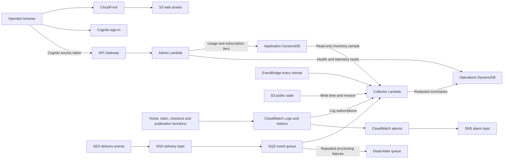

# Admin page

The DropDeck admin page at `/ops/` provides merchant management, usage and billing previews, and operational diagnostics. Access requires a signed-in Cognito user in the `operators` group; the backend checks membership on every admin request.

The implementation is available on `feat/ops-health-recovery` and has been validated locally. The monitoring resources have not been deployed by this branch. Monitoring is disabled by default and requires `operationsEnabled=true` in CDK context or the target stage's `stageSettings`. Business analytics work independently of this setting; Operations displays an unconfigured message when monitoring is unavailable.

## Shops & billing

The month selector controls the existing shop totals and billing overview. Operators can view merchant identities, change their subscription tier, and inspect drops, buyer sessions, orders, sales and bill previews. The available tiers are Starter, Growth and Event.

Business analytics add:

- Current merchant plan distribution.
- Six months of buyer-session trends ending in the selected month.
- Per-merchant drops, session allowance consumption and billing previews.
- Pagination through groups of up to 25 merchants, with partial-read warnings.

The new charts and allowance table cover only their current merchant page. The existing shop overview retains its separate totals. Usage is posted when a drop finishes, so active drops can lag behind the displayed monthly figures. Sessions count activity rather than unique people. Plan distribution reflects current tiers, and bill previews use current pricing; historical subscription changes are not reconstructed. Billing previews do not create invoices or collect payment.

## Operations

The Operations tab lists up to 25 registered drops per page. Operators can search the current page by drop or merchant ID, filter for drops needing attention, refresh the view and select a drop for details. Summary cards show drops on the page, drops needing attention, unknown health and failures from the latest collection batch.

Each drop displays its lifecycle, health status, controller heartbeat, last public state write to S3 and inventory comparison. Details include detected issues, observation time, source/public revisions and the last publication attempt. Selected-drop telemetry supports 15-minute, 1-hour and 24-hour windows and includes:

- Tickets issued, claim attempts, new holds and confirmation attempts.
- API 5xx responses, application 429s and attributable API Gateway 429s.
- Mean handler latency and a request-volume chart.
- SES acceptance, delivery, delays, send failures, bounces, complaints and rejections, plus OTP verification at checkout.
- The latest ten recorded health transitions.

Health refreshes every 15 seconds while the page is visible; selected-drop telemetry refreshes every 30 seconds. Times are displayed in Singapore time. A CloudWatch dashboard link provides aggregate service p50/p95 latency and monitoring graphs for the deployed stage.

## Interpreting health and metrics

Health collection older than three minutes is unknown. A live drop without a heartbeat for more than 90 seconds is flagged. Publication failures remain visible until a later success; lifecycle differences, missing public state and older or unavailable source revisions are also reported. An unchanged public state can have an older S3 timestamp while its controller remains healthy. S3 write evidence does not establish CloudFront cache freshness.

Inventory compares total stock-shard `sold` counters with active hold quantities plus recorded order quantities. Expired active holds are flagged after a 10-second sweep allowance. Reads are bounded to 200 holds and 200 orders per drop; continuation or missing/unprocessed stock rows marks the sample incomplete.

These reads are not an atomic snapshot: the active-hold index is eventually consistent, other reads can race with checkout, and confirmed holds can temporarily lack order records. The comparison is per drop rather than a per-shard reservation ledger. A discrepancy needs investigation, and a matching sample does not prove every shard is correct. The page provides no stock-adjustment or hold-release action.

Ticket issuance counts HTTP 201. A claim returning HTTP 201 counts as a new hold; duplicate HTTP 200 claims count only as attempts. Confirmation attempts can include retries. OTP verification is recorded after the first successful hold-confirmation transition. SES acceptance means the send request succeeded; delivery means the recipient mail server accepted the message, without confirming inbox placement or reading. Test/log mode is identified explicitly.

Application 429s include lockouts and rate limits. API Gateway 429s are collected separately even when Lambda does not run. Per-drop edge attribution covers ticket/claim URLs, which contain drop identity; opaque checkout URLs cannot safely be attributed. The stage CloudWatch dashboard includes all edge 429s.

Operational counts are diagnostic estimates. Identical batch retries are deduplicated, but overlapping rebatched events or duplicate provider notifications can overcount. Missing telemetry can indicate idle traffic or delayed ingestion. These counts are not billing input or unique-buyer counts.

## AWS architecture and service choices

The admin page combines existing merchant usage records with a separate operational read model. Browser refreshes read stored summaries; telemetry ingestion and scheduled health collection run independently of checkout.



| AWS service | Role in DropDeck | Reason for using it |
| --- | --- | --- |
| S3 and CloudFront | Host the static UI and published shop/drop state; the collector reads public state objects from S3 | Static assets and shared state can be served through the CDN without invoking application functions for every view. S3 metadata provides publication evidence. |
| Cognito | Managed sign-in and access tokens for merchant/admin requests | Reuses the existing authentication system. The admin backend additionally requires the `operators` group. |
| API Gateway | Routes HTTP requests, validates Cognito tokens on admin routes and captures access logs | Provides a managed API entry point and exposes throttling that occurs before Lambda runs. |
| Lambda | Runs the admin API and event/schedule-driven collector | Fits short request and collection tasks without maintaining servers. Telemetry processing stays separate from buyer transactions. |
| DynamoDB | Stores merchant profiles/monthly usage and, in a separate table, operational summaries and history | Merchant/drop keys support bounded queries. Stored summaries keep dashboard refreshes from repeatedly scanning transaction records or querying logs. Operational estimates remain separate from billable usage. |
| EventBridge | Invokes collection every minute | Checks for missing heartbeats and stale publication even during periods without buyer requests. |
| CloudWatch | Application logs, extracted metrics, native dependency metrics, dashboards and alarms | Connects business outcomes such as publication failures with Lambda/DynamoDB failures, API throttling and latency. Stage/service dimensions limit custom-metric growth. |
| SES | Sends checkout OTP emails and publishes provider outcomes through a configuration set | Supports actual email sending and distinguishes acceptance, delivery, delays, bounces, complaints and rejections. |
| SNS | Routes SES events to SQS and receives alarm notifications on a separate topic | Separates event producers from consumers and lets notification destinations be configured independently. |
| SQS and its dead-letter queue | Buffer SES events and retain repeatedly failing messages for investigation | Temporary processing failures can be retried independently of checkout. Partial-batch responses retry failed messages while preserving successfully processed work. |
| IAM | Assigns function and AWS service permissions | The collector can read application inventory and S3 state but cannot change stock; its writes are limited to the operations table. |

CloudWatch extracts metrics from structured EMF logs. Tenant, drop and request IDs remain correlation fields instead of metric dimensions because each unique dimension combination creates another metric series. Operational metrics still incur log, metric and alarm costs. See [CloudWatch cost guidance](https://docs.aws.amazon.com/AmazonCloudWatch/latest/monitoring/cloudwatch_billing.html).

SES configuration-set events follow the SNS/SQS path in the diagram. A delivery event confirms acceptance by the recipient mail server rather than inbox placement or reading. Event processing can receive duplicates; receipts suppress identical batch retries, while counts remain diagnostic estimates. See [SES event publishing](https://docs.aws.amazon.com/ses/latest/dg/event-publishing-add-event-destination-sns.html) and [Lambda partial-batch handling](https://docs.aws.amazon.com/lambda/latest/dg/services-sqs-errorhandling.html).

## Backend and monitoring configuration

The admin API exposes these operator-protected routes:

| Route | Purpose |
| --- | --- |
| `GET /admin/tenants` | Monthly shop overview and billing previews |
| `PATCH /admin/tenants/{tenantId}` | Change a merchant's subscription tier |
| `GET /admin/analytics` | Paginated business analytics for the selected month |
| `GET /admin/health` | Paginated drop health and collector status |
| `GET /admin/health/{tenantId}/{dropId}` | Drop telemetry and recent health transitions |

When enabled, monitoring provisions a separate operations DynamoDB table, a collector Lambda, a minute EventBridge rule, application/API log subscriptions, CloudWatch metrics/dashboard/alarms, an SNS alarm topic, and an encrypted SES delivery-event queue with a dead-letter queue. Configuring `mailFrom` also adds an SES configuration set and SNS delivery routing. SES configuration and sender verification are specific to the AWS account and region.

Drop publications and controller heartbeats register drops automatically. Historical drops appear after their next publication or controller activity. The collector samples at most 20 registry records per invocation with four parallel reads and a 90-second lease; larger registries take multiple cycles. It has read-only access to the application table and S3 state objects, and writes only to the operations table. Request handlers emit telemetry without synchronous monitoring network calls. CloudWatch metric dimensions use stage/service, keeping tenant and drop IDs as correlation fields.

The configured alarm thresholds are:

| Signal | Rule |
| --- | --- |
| Service 5xx | >1%, with at least 50 requests and 10 errors per period, for two consecutive 5-minute periods |
| Service latency | p95 >1.5 seconds, with at least 50 requests per period, for two consecutive 5-minute periods |
| API Gateway 429s | >5%, with at least 50 requests and 20 throttles per period, for two consecutive 5-minute periods |
| Lambda errors/throttles and DynamoDB throttling/system errors | Nonzero for two consecutive 5-minute periods |
| Collection failures | Nonzero for two consecutive minute periods |
| Missing collector | Fewer than one run per minute for three periods; missing data breaches |
| Affected drops in the collection sample | Nonzero for three consecutive minute periods |
| Publication failure or OTP send failure/delay/bounce/complaint/rejection | Nonzero in one minute period |
| SES queue backlog | Oldest message >120 seconds for two consecutive minute periods |
| SES dead-letter queue | Any visible message |

Alarms publish to the stack's `AlarmTopicArn` output. No notification recipient is configured by this implementation. Thresholds have local infrastructure-test coverage; live alarm transitions, notification delivery and workload tuning have not been validated in AWS.

## Production data and preview separation

Normal production builds use the deployed AWS services. Simulated data is enabled only for local demo development or an explicit review build; removing the review banner does not change that distinction.

| Mode | Command and flags | Data and authentication |
| --- | --- | --- |
| Local demo | `pnpm dev:demo` | Browser-local merchant/buyer fixtures and generated admin metrics; demo sign-in shortcuts |
| Explicit review export | `pnpm web:review-build` sets both `DROPDECK_DEMO=1` and `DROPDECK_REVIEW_BUILD=1` | Simulated UI packaged into `apps/web/review-out` for the separate review-site stack |
| Normal deployment build | `pnpm web:build`, with `DROPDECK_REVIEW_BUILD` unset | Normal Cognito authentication and the backend identified by the deployed `/config.json`; exported to `apps/web/out` |

`next.config.mjs` sets the browser's `NEXT_PUBLIC_DROPDECK_DEMO` flag at build time. A normal production build disables the flag even if `DROPDECK_DEMO=1` remains in the shell, provided the explicit review-build flag is unset. Preview imports and authentication shortcuts are excluded from that export. Browser preview data in `localStorage` does not populate AWS tables or replace production API responses.

The application stack deploys `apps/web/out` and writes `/config.json` with the target stage's API endpoint, Cognito settings and mail mode. The separate review-site stack uses `apps/web/review-out`. `operationsEnabled=true` controls monitoring infrastructure only; it does not enable demo mode. With monitoring disabled, Operations reports that monitoring is unconfigured rather than substituting sample data.

CI runs `pnpm web:verify-production` after the web build in both the checks and staging deployment jobs. The check rejects preview routes and known fixture/demo-authentication markers before the deployment step. For a manual production build, run:

```sh
env -u DROPDECK_REVIEW_BUILD DROPDECK_DEMO=0 pnpm web:build
pnpm web:verify-production
```

Use the normal application stack and the intended account/stage configuration for a live deployment. Live OTP delivery additionally requires the verified SES sender for that account/region; the stack rejects a `prod` stage without `mailFrom`.

## Data protection and current limits

Operational snapshots exclude buyer names, email addresses, OTP values, authorization tokens and raw provider payloads. Raw SES events can contain personal data; queues use managed encryption, restrict service access and redact events before operations-table persistence. Infrastructure administrators with broader IAM permissions can still access service logs and queues.

Minute/hour metrics and deduplication receipts expire after 48 hours, sampled registry records two days after drop end, and health transitions after 30 days. Monitoring logs retain for one month; SES events retain for four days and dead-letter events for fourteen days. DynamoDB TTL deletion is asynchronous. Removing deployed monitoring retains its operations table but destroys its log groups and queues under the current stack policies.

Operations is read-only. It has no publication retry jobs, reservation reconciliation, incident acknowledgment controls or operator mutation audit trail. The timeline records sampled health changes rather than operator actions. Existing controller expiry sweeping continues independently.

Local validation covers authorization, pagination, telemetry redaction and attribution, stale/partial health, retry deduplication, collector leases and unchanged inventory against DynamoDB Local. Infrastructure assertions cover permissions, event routing, queues and alarms. Local simulated UI fixtures support review and are excluded from normal production exports.
