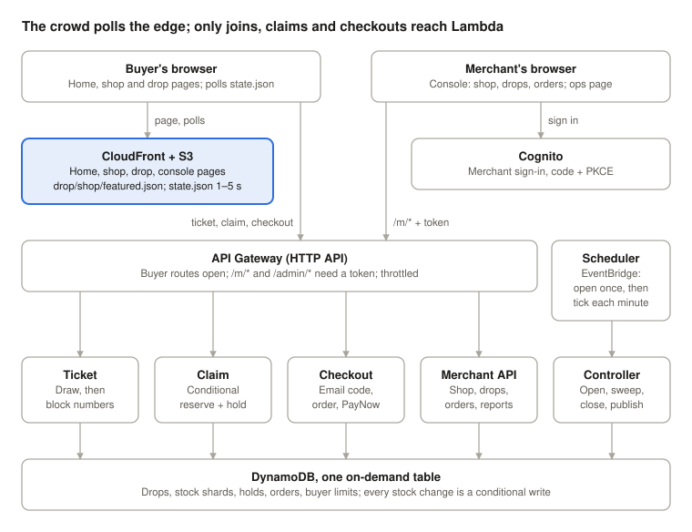

# Cost: bill of materials and platform comparison

What DropDeck costs to run, what a drop costs, and how that compares with a classic server-based design and with running it on our own servers. The tables between the markers come from `eval/cost-model.ts`; change an assumption there and run `pnpm --filter @dropdeck/eval cost -- --write`. Once a real drop is instrumented, `--measured <file>` replaces the modelled workload.

## How the architecture maps onto a classic web-app design

A classic scalable web app splits its work into stages (content in, heavy processing, delivery), puts EC2 web servers behind a load balancer with auto scaling, joins the stages with a queue, and serves readers from a CDN. DropDeck has the same parts, as managed services that cost nothing while idle:

| Classic piece | DropDeck | Service model |
| --- | --- | --- |
| Content in (users send data) | Merchant console → merchant API → `drop.json`, `shop.json`, `featured.json` (homepage list), uploaded images in S3 | PaaS (API Gateway, Lambda), IaaS (S3) |
| Heavy processing (not user-facing) | The burst: ticket, claim and checkout functions writing sharded DynamoDB counters; the controller ticking | PaaS (Lambda, DynamoDB, EventBridge Scheduler) |
| Delivery via CDN | CloudFront serves the pages, `state.json` (the waiting room) and photos from the edge | SaaS-style managed CDN |
| Load balancer + EC2 auto scaling | API Gateway + Lambda: scales per request, nothing to provision | PaaS |
| Queue between stages (SQS) | EventBridge Scheduler opens drops; the controller "messages" every waiting buyer by publishing one cached `state.json` | PaaS |
| Users' web browser / media player | Phone browser; the delivery channel, not part of the system | (client) |

**No rework needed.**
- The burst stage never touches a server we run.
- The CDN carries the read load, which is where a crowd's traffic is.
- A load balancer alone would cost about US$24 a month with nothing happening.

## WAF, DDoS and autoscaling (decided)

- **DDoS:** AWS Shield Standard protects every CloudFront distribution at no cost.
- **Denial of wallet:** it is bounded by the API stage throttle (1,000 requests a second; tickets have their own 600) and by the budget alarm. A million junk API calls cost about US$1.60.
- **WAF is not added.**
  - It cannot attach to an API Gateway HTTP API. On the main CloudFront distribution it would also inspect every waiting-room poll: US$0.60 per million, about +US$0.50 per reference drop, plus US$6 a month.
  - The upgrade path, if a drop is ever attacked:
    - **Fixed price:** WAF with an IP rate limit on a separate, API-only CloudFront distribution. That is US$6 a month and fractions of a cent per drop (platform B below).
    - **Flat rate:** a CloudFront flat-rate plan. Pro is US$15 a month for 10M requests, with WAF included and no overage charges; Business is US$200 a month for 125M.
- **Autoscaling** is built into Lambda, API Gateway and on-demand DynamoDB.
  - The ceiling that matters is the account's Lambda concurrency quota. In the sandbox it is **400** (checked 2026-10-07 with `aws lambda get-account-settings`), shared by every stage and function in the account.
  - Running copies answer a join in about 15 ms, so 400 would carry thousands of calls a second. A crowd arriving together meets new copies instead, whose first request takes about 1.25 s (start plus first run), so about 320 joins a second used all 400 in `eval/load.ts` runs (2026-10-13 to 10-16) and the excess was refused with 503. The ticket function is capped per stage (`ticketConcurrency`) and the buyer page spreads and retries joins; `docs/degradation.md` has the numbers.
  - Cold starts at the opening second can be removed with provisioned concurrency for just the drop window (about US$0.04 per drop, included in platform B). Whether it is needed comes from the elasticity measurement.

## What drives the cost

- **Waiting-room polling is the cost.** Every buyer's page re-reads `state.json` from CloudFront, so cost follows buyers × minutes on the page × polls a minute. Everything behind the API costs a few cents per drop, because it is bounded by stock, not by the crowd.
- **Adaptive polling, as built** (`pollInterval` in `apps/web/app/d/buyer.ts`; it replaced a fixed 2 s poll) polls fast only when something can change for that buyer:
  - every 30 s during a far-off countdown
  - every 2 s from 2½ minutes before the queue opens
  - every 5 s when more than 300 people are ahead
  - every 10 s once holding stock
  - every 15 s in a background tab
- **Measured:**
  - **Built site (playwright):** a phone left on a countdown page for 5 minutes made **11** polls, against 150 at a fixed 2 s. A first page load is 18–19 requests and 270–590 KB depending on photos.
  - **Deployed on dev-simon, 2026-10-07:**
    - a countdown two days out: **7 polls in 3 minutes**, every 30 s
    - a drop whose queue opened during the test: 76 polls in 3 minutes, switching to every 2 s once inside the last 2½ minutes
- **Always-free allowances** (CloudFront 10M requests and 1 TB a month, Lambda, Scheduler) absorb the first few drops each month on a normal account. Whether they apply to the NUS sandbox's credit account cannot be checked: the sandbox's service control policy denies the Free Tier API. So every figure below is shown without them unless marked.

<!-- BOM:START -->
_Generated by `eval/cost-model.ts` (modelled inputs). Prices: AWS on-demand, ap-southeast-1, price list of 2026-10-07. US$ unless marked._

### Per drop (reference drop: 200 units, 5,000 buyer sessions)

| Item | As built (adaptive): quantity | As built | Fixed 2 s (replaced): quantity | Fixed 2 s |
| --- | --- | --- | --- | --- |
| CloudFront requests (pages + state.json polls) | 0.81M (0.71M polls) | $0.97 | 1.90M (1.80M polls) | $2.27 |
| CloudFront data out | 2.6 GB | $0.31 | 3.2 GB | $0.39 |
| CloudFront Functions (URL rewrite) | 15k | <$0.01 | 15k | <$0.01 |
| API Gateway (HTTP API) | 7.3k | <$0.01 | 7.3k | <$0.01 |
| Lambda (ARM, 512 MB) incl. controller | 1.5k GB-s | $0.02 | 1.5k GB-s | $0.02 |
| DynamoDB on-demand | 7.1k W / 23.2k R | <$0.01 | 7.1k W / 23.2k R | <$0.01 |
| S3 (state.json writes, edge refills) | 1080 PUT / 4050 GET | <$0.01 | 1080 PUT / 4050 GET | <$0.01 |
| EventBridge Scheduler | 46 | <$0.01 | 46 | <$0.01 |
| SES email codes | 173 | $0.02 | 173 | $0.02 |
| CloudWatch Logs | 4.3 MB | <$0.01 | 4.3 MB | <$0.01 |
| **Total per drop** |  | **$1.35** |  | **$2.73** |
| With the always-free CloudFront allowance (1 drop a month) |  | $0.38 |  | $0.46 |

Polls per session: 142 as built, against 360 with the fixed 2 s poll it replaced (2.5× fewer). Session time by phase (assumed): countdown 5 min, near the front 3 min, far back 3 min, holding 1 min.

### Sensitivity: cost per drop against how long buyers keep the page open

| Minutes on page | 5 | 10 | 15 | 20 | 30 |
| --- | --- | --- | --- | --- | --- |
| As built (adaptive) | $0.82 | $1.20 | $1.58 | $1.96 | $2.71 |
| Fixed 2 s (replaced) | $1.40 | $2.35 | $3.30 | $4.25 | $6.15 |

### Fixed monthly cost of each platform (no drops at all)

| Platform | Idle month | Per reference drop | Note |
| --- | --- | --- | --- |
| A. DropDeck as built (adaptive polling) | $0.05 | $1.35 | pay per use; idle month ≈ storage only |
| B. A + WAF on the API + warm Lambdas | $6.05 | $1.39 | optional hardening, not built |
| C. Classic servers: ALB + EC2 auto scaling + cache | $161 | $1.61 | always-on servers; +4 × c7g.large for 1 h per drop |
| D. On-premise behind the same CDN | $550 | $1.33 | servers and staff time fixed; CloudFront for pages and polls |

A. DropDeck as built (adaptive polling): fixed items

| Item | Quantity | Per month |
| --- | --- | --- |
| S3 storage (site, images, JSON) | ~2 GB | $0.05 |
| DynamoDB storage | < 25 GB | $0.00 |
| Cognito (Essentials, < 10k monthly users) | - | $0.00 |
| Budget alarm, SSM parameters, CloudFront (idle) | - | $0.00 |

B. A + WAF on the API + warm Lambdas: fixed items

| Item | Quantity | Per month |
| --- | --- | --- |
| S3 storage (site, images, JSON) | ~2 GB | $0.05 |
| DynamoDB storage | < 25 GB | $0.00 |
| Cognito (Essentials, < 10k monthly users) | - | $0.00 |
| Budget alarm, SSM parameters, CloudFront (idle) | - | $0.00 |
| WAF web ACL + 1 rate rule (API-only distribution) | - | $6.00 |

C. Classic servers: ALB + EC2 auto scaling + cache: fixed items

| Item | Quantity | Per month |
| --- | --- | --- |
| Application Load Balancer (+1 LCU) | 730 h | $24 |
| EC2 web/queue servers, 2 × t4g.medium (two AZs) | 1460 h | $62 |
| EBS gp3, 2 × 20 GB | 40 GB | $3.84 |
| ElastiCache Valkey t4g.small (queue state) | 730 h | $28 |
| NAT gateway (private subnets) | 730 h | $43 |
| S3, DynamoDB, Cognito as above | - | $0.05 |

D. On-premise behind the same CDN: fixed items

| Item | Quantity | Per month |
| --- | --- | --- |
| 2 × 1U servers (HA pair), S$3,500 each over 36 months | - | $150 |
| Colocation, 2U with power and 100 Mbps, Singapore | - | $231 |
| Operations (patching, backups, on-call), 4 h at S$50 | - | $154 |
| Off-site backup and domain/TLS | - | $15 |

### Monthly cost against revenue as the business grows

Merchant mix (assumed): 60% Starter (2 small drops), 30% Growth (4 reference drops), 10% Event (1 small drop). A small drop is a fifth of the reference drop. Revenue at S$1.30 per US$.

| Platform | 10 shops: cost | 50 shops: cost | 200 shops: cost | 10 shops: gross margin | 50 shops: gross margin | 200 shops: gross margin |
| --- | --- | --- | --- | --- | --- | --- |
| A. DropDeck as built (adaptive polling) | $20 | $98 | $393 | 96% | 96% | 96% |
| B. A + WAF on the API + warm Lambdas | $26 | $107 | $411 | 95% | 96% | 96% |
| C. Classic servers: ALB + EC2 auto scaling + cache | $185 | $279 | $632 | 63% | 89% | 94% |
| D. On-premise behind the same CDN | $569 | $647 | $938 | -13% | 74% | 91% |
| Revenue (all platforms) | $504 | $2519 | $10077 |  |  |  |

At 200 shops that is 500 drops a month (240 reference-size). Margins exclude people, payment fees and taxes.

### Small-seller scenario

Assumed: every shop on Starter (S$29 a month), 2 drops a month of 40 units and 400 buyer sessions each. As built, one such drop costs $0.13.

| Platform | 10 shops: cost | 50 shops: cost | 200 shops: cost | 10 shops: gross margin | 50 shops: gross margin | 200 shops: gross margin |
| --- | --- | --- | --- | --- | --- | --- |
| A. DropDeck as built (adaptive polling) | $2.58 | $13 | $51 | 99% | 99% | 99% |
| B. A + WAF on the API + warm Lambdas | $9.34 | $23 | $72 | 96% | 98% | 98% |
| C. Classic servers: ALB + EC2 auto scaling + cache | $170 | $205 | $335 | 24% | 82% | 92% |
| D. On-premise behind the same CDN | $553 | $565 | $611 | -148% | 49% | 86% |
| Revenue (all platforms) | $223 | $1115 | $4462 |  |  |  |

<!-- BOM:END -->

## Reading the comparison

- **Serverless is the cheapest platform at every size modelled.** The idle month costs cents, so a quiet month cannot make the service insolvent. The classic stack costs about US$161 a month before the first drop, and on-premise about US$550.
- **On-premise is shown behind the same CDN as the cloud platforms.** A 100 Mbps colocation link carries only about three reference drops' pages and polls at once, so serving the crowd from the servers is not a realistic alternative. Its per-drop cost is therefore close to DropDeck's; the difference is the fixed cost. Only the on-premise row includes staff time (about US$154 a month); adding the same time to the cloud rows would not change the order.
- **Without the CDN, on-premise would undercut DropDeck at about 290 shops** in the reference mix, which is why the CDN assumption matters. The levers that keep the serverless cost down as drops multiply:
  - polling intervals (the biggest lever; see the sensitivity table)
  - a CloudFront flat-rate plan, which caps request cost
  - pushing admission updates instead of polling them
- **The margins depend on the merchant mix.** The reference mix assumes every Growth shop runs four 5,000-session drops and pays for the extra sessions, which is most of the revenue. The small-seller scenario (all Starter, small drops) is closer to the sellers surveyed; serverless keeps a high margin there, while at 10 shops classic servers keep about a quarter of revenue and on-premise loses money.
- **No single always-on server was benchmarked** against the reference peak, so the on-premise sizing is a planning estimate.

## Assumptions to replace with measurements

| Assumption | Value | How to measure |
| --- | --- | --- |
| Minutes on the page per session, by phase | 5 countdown, 3 near the front, 3 far back, 1 holding | CloudFront request count for one seeded drop ÷ sessions |
| Sessions per reference drop | 5,000 | `USAGE#` records (`GET /m/usage`, the ops page) |
| Orders per unit, holds per order | 1 per 1.5 units, 1.3 | `USAGE#` orders and units; hold count from the logs |
| Merchant mix and drops per month | 60/30/10 Starter/Growth/Event | Pilot merchants |
| On-premise costs | S$3,500 per server, S$300 colocation, 4 h ops a month | Planning estimates from list prices; replace with quotations |
| Exchange rate | S$1.30 per US$ | — |
