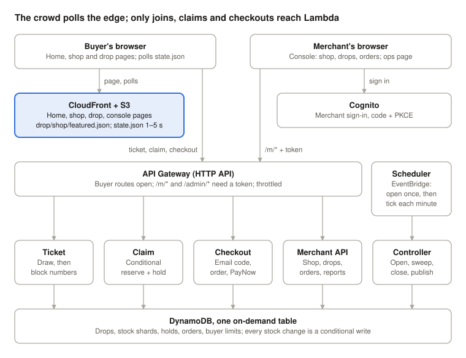

# Handover

State of the build on 5 Oct 2026, written for the 19 Oct handover (decision 0010). From then **Liwen and Fung Wei**
own enhancements, unhappy paths and testing; **Gurbind and Shaowei** own recruitment, the user study and the
business case.

**For now, staging runs in Simon's AWS account**, so only Simon can open its AWS console and logs. Everyone can
still deploy staging (push to `main`) and run a full copy in their own account. The team can move staging to
someone else's account later; both are explained in [Run DropDeck in your own AWS account](#run-dropdeck-in-your-own-aws-account).

Read this, then [`api.md`](api.md), [`degradation.md`](degradation.md) and the [decision log](decisions/README.md).



Waiting buyers only fetch cached files from CloudFront, so a bigger crowd costs almost nothing at the origin. The
merchant API writes `drop.json` and the open schedule; the controller writes `state.json` every tick; checkout sends
email codes (log mode for now). The picture is [`architecture.svg`](architecture.svg), also usable in the report.

## Where things stand

The full drop lifecycle is built, deployed and tested end to end on AWS:

- **Merchant console** (`/m/`): sign-in, shop profile with PayNow details, drop editor, schedule, unschedule,
  cancel, duplicate, live view, orders with paid / no-show reconciliation, CSV export, post-drop report.
- **Buyer page** (`/d/{tenant}/{drop}/`): countdown, random draw before open then first-come, queue position,
  claim, hold countdown, email code, PayNow confirmation. Progress survives a refresh.
- **Back end**: ticket, claim, checkout, merchant API, and a controller that opens drops, publishes the watermark,
  sweeps expired holds, sets sold-out flags and closes drops.

Evidence, all in the repo:

| What | Where | Result |
| --- | --- | --- |
| Unit tests | `pnpm test` | 50 |
| Integration tests (real handlers, DynamoDB Local) | `pnpm test:int` | 31; also a CI job on every push |
| Oversell on AWS | `eval/results/2026-10-05-oversell/` | 200 buyers / 20 units and 500 / 50: sold exactly min(N, M) |
| Lifecycle on AWS (open, draw, claim, expiry, cancel, close) | `eval/results/2026-10-05-e2e/` | all 24 steps pass |

## Repo map

| Path | What |
| --- | --- |
| `packages/shared` | Types, keys, tokens, admission maths, email normalisation. `@dropdeck/shared/ddb` (table access, conditional hold release) and `/secrets` (SSM keys) are server-only subpaths |
| `services/ticket`, `claim`, `checkout` | Buyer API. `checkout/src/otp.ts` and `mailer.ts` are the email code |
| `services/controller` | Scheduler target: `handler.ts` (open, tick loop), `ops.ts` (sweep, sold-out, close) |
| `services/merchant-api` | Console API. `reports.ts` builds the report and CSV |
| `apps/web` | Next.js static export. `app/d/` buyer page, `app/m/` console, `lib/` config, auth (PKCE), API client |
| `infra` | CDK: `DropDeck-<stage>` and the one-off `DropDeck-GithubOidc` |
| `tests/integration` | In-process handlers against DynamoDB Local |
| `eval` | `oversell.ts`, `e2e.ts`, `seed.ts`, merchant study kit, results |
| `scripts` | `put-secrets.sh`, `test-int.sh` |

## Set up a machine

```bash
nvm use                 # Node 22 (.nvmrc); the CI uses 22 too
corepack enable         # pnpm 10
pnpm install
pnpm typecheck && pnpm test && pnpm web:build
pnpm test:int           # needs Docker; starts DynamoDB Local on port 8765
```

## Environments

| Stage | AWS account | Site | Deployed by |
| --- | --- | --- | --- |
| `staging` | Simon's NUS sandbox `337542796977` (for now) | https://d1n4z7b90ypcvj.cloudfront.net | CI, on every push to `main` |
| `dev-simon` | same | https://d1n09y64wfzcgp.cloudfront.net | Simon, by hand |
| `dev-<you>` | your own NUS sandbox | yours | you |

All stages are in `ap-southeast-1`. The budget alarm (US$10 a month, alerts at $5 and $10 to Simon) watches
Simon's whole sandbox account. Both stages send email codes in **log mode**: buyers see their code on screen (see gaps).

## Run DropDeck in your own AWS account

Every student has their own NUS sandbox account (US$50 credit), so anyone can run a complete DropDeck: console,
buyer page, scheduler, everything. There are two ways to use it.

### A. Your own copy (`dev-<you>`): anyone, any time

**What you need:** the machine set up as above, the [AWS CLI v2](https://docs.aws.amazon.com/cli/latest/userguide/getting-started-install.html),
and your account ID from the [NUS AWS portal](https://nus-aws-cloud.awsapps.com/start) (Accounts tab).

**1. Tell the AWS CLI about your account.** Add this to `~/.aws/config`, with your own account ID:

```ini
[sso-session nus]
sso_start_url = https://nus-aws-cloud.awsapps.com/start
sso_region = ap-southeast-1
sso_registration_scopes = sso:account:access

[profile dropdeck]
sso_session = nus
sso_account_id = <your account id>
sso_role_name = nusisb_IsbUsersPS
region = ap-southeast-1
```

**2. Log in.** It prints a link and a code; open the link in your browser and approve. Logins last a few hours;
run it again when commands start saying your token expired.

```bash
aws sso login --profile dropdeck --use-device-code --no-browser
export AWS_PROFILE=dropdeck AWS_REGION=ap-southeast-1
```

**3. Deploy** (from the repo root; the first time takes about 5 minutes):

```bash
pnpm web:build
cd infra
npx cdk bootstrap -c allowedAccounts=<your account id>          # once per account
../scripts/put-secrets.sh dev-<you>                              # once per stage
npx cdk deploy DropDeck-dev-<you> -c stage=dev-<you> -c allowedAccounts=<your account id> --require-approval never
cd ..
```

The deploy prints your `SiteUrl`. A line saying "could not be used to assume ... Proceeding anyway" is expected:
the sandbox does not allow the usual CDK roles, and the deploy works without them (decision 0008 amendment).

**4. Use it.** Open `<SiteUrl>/m/`, create an account, then load a demo shop so you are not typing drops by hand:

```bash
pnpm seed -- --stage dev-<you> --owner <the email you signed up with> --clear
```

**5. Tidy up** when you stop for more than a day (idle cost is near zero, but there is no reason to keep it):

```bash
cd infra && npx cdk destroy DropDeck-dev-<you> -c stage=dev-<you> -c allowedAccounts=<your account id>
```

Tip: to stop typing `-c allowedAccounts=...`, add your account ID to `allowedAccounts` in `infra/cdk.json` and
commit it. The list only stops deploys to accounts nobody meant to use.

### B. Move staging to another account: if the team decides to

Staging is whatever CI deploys on a push to `main`, so moving it means pointing CI at a different account. The new
owner does this once, with option A's steps 1 and 2 done for their account:

1. Add their account ID to `allowedAccounts` in `infra/cdk.json`.
2. Create the role GitHub deploys with, and the signing keys:
   ```bash
   cd infra
   npx cdk bootstrap -c allowedAccounts=<their account id>
   npx cdk deploy DropDeck-GithubOidc -c githubRepo=simonkp/cs5224-dropdeck \
     -c githubSubPrefix=repo:simonkp@5468350/cs5224-dropdeck@1405294986 -c allowedAccounts=<their account id>
   ../scripts/put-secrets.sh staging
   ```
   The `githubSubPrefix` is this repo's GitHub identity; it stays the same whoever owns staging.
3. In GitHub, set the repository variables (Settings → Secrets and variables → Actions → Variables; needs repo
   admin, so Simon or a collaborator with admin): `AWS_DEPLOY_ROLE_ARN` = the `DeployRoleArn` the deploy printed,
   and `BUDGET_EMAIL` = where budget alerts should go.
4. Commit step 1 and push. CI deploys a fresh staging into the new account. The site URL changes: tell the team and
   update this doc.
5. In the old account: `npx cdk destroy DropDeck-staging -c stage=staging`, and optionally `DropDeck-GithubOidc`.

Staging's data (drops, orders) does not move with it; load demo data with `pnpm seed -- --stage staging --owner <email>`.

## Runbook

| Task | Command or place |
| --- | --- |
| Deploy staging | Merge to `main`. CI runs typecheck, tests, web build, synth, integration, then deploys and smoke-tests |
| Deploy a dev stage | `npx cdk deploy DropDeck-<stage> -c stage=<stage>` from `infra` (after `pnpm web:build`) |
| Signing keys for a new stage | `scripts/put-secrets.sh <stage>`, once, before the first deploy |
| Demo data | `pnpm seed -- --stage <stage> --owner <email> [--clear] [--opens-in N]` (`--clear` refuses non-dev stages without `--force`) |
| Lifecycle smoke test (~9 min) | `pnpm --filter @dropdeck/eval e2e -- --stage <stage>` |
| Oversell experiment | `pnpm --filter @dropdeck/eval oversell -- --stage <stage> --n 500 --m 50` |
| Logs | CloudWatch Logs `DropDeck-<stage>-<Function>Logs…`; metric lines are listed at the end of `api.md` |
| Scheduler lag | Logs Insights on the controller: `filter msg = "opened" \| stats max(lagMs)` |
| Re-deploy the GitHub role | `npx cdk deploy DropDeck-GithubOidc -c githubRepo=simonkp/cs5224-dropdeck -c githubSubPrefix=repo:simonkp@5468350/cs5224-dropdeck@1405294986` (staging's account) |
| Real email | Verify a domain in SES, then deploy with `-c mailFrom="DropDeck <codes@your.domain>"`; for staging, add it to the `cdk deploy` line in `.github/workflows/ci.yml` |

CloudTrail lookups are denied in the sandbox: diagnose from CI logs and Lambda logs.

## Rules that keep it correct

These are the properties the report claims. Each has a test; run `pnpm test:int` after touching anything nearby,
and if you change a guard, break it on purpose once to check a test fails.

1. **Stock moves only by conditional writes.** Reserve is `sold <= capacity - q` on one shard, sweeping the other
   shards before "sold out". Release is a conditional flip `active → released` (and, for the sweep, only if
   expired). Never return units without winning that flip.
2. **Reserve before hold.** A crash between them undersells; the other order oversells.
3. **Admission is a function of time and the frozen early-group size**, so claims need no ticket table and
   overlapping controllers agree. Every controller write is either a function of time or conditional.
4. **The claim window starts at max(admission time, ticket issue time).** Late arrivals below the admission rate
   would otherwise be refused on arrival.
5. **Tickets are refused before `entryOpensAt`** even though the drop goes Live up to 90 s earlier (scheduler lag).
6. **Never cache-bust `state.json`.** Its cache key ignores query strings; polling cost must not scale with the crowd.
7. **Reports count orders, never stock counters.**
8. **One order per normalised email per drop**, enforced by a conditional put at confirm.

## Known gaps, in priority order

1. **Email is in log mode on every stage.** Before the merchant sessions (from 26 Oct) and the cohort drop
   (30 Oct): buy a domain, verify it in SES with DKIM, request SES production access (staging's URL works for the
   form), then set `mailFrom` for staging. Otherwise run those drops with buyer check "None". The SES branch of
   the mailer has never run; the Resend fallback needs a key at `/dropdeck/<stage>/resend-api-key` and
   `-c resendFallback=true`.
2. **Sandbox lease.** Unknown end date; the account is wiped at the end. If it ends before marking, staging and
   the cohort drop move to a member's own account (Simon is asking the module staff).
3. **For now only Simon can see staging's AWS console and logs**, because sandbox accounts are per student. Deploy
   staging by pushing to `main`, debug on your own copy, or move staging (option B above) if the team prefers.
4. **Evaluation tooling (Phase 5, Liwen):** k6 load at 1×, 3×, 10× and a ramp; counter ceiling by shard count;
   fairness from the `ticket` log lines (draw on vs off); elasticity at open; cost per drop. Metrics are
   structured log lines today, not CloudWatch metrics (EMF would make dashboards cheap).
5. **Checkout UX:** after a refresh the hold page forgets a code was sent, and a buyer spends another of their
   three sends. `GET /api/holds/{id}` already returns `codeSent`.
6. **Misuse defences beyond the per-email limit** (named, not built): proof-of-work at ticket issue, per-IP limits
   (needs WAF, which bills by the hour), Turnstile. Extra sessions buy better odds, not more orders.
7. **Merchant sign-up is open** to anyone with an email. Pricing tiers (decision 0007) are not enforced; `tier`
   is always `starter`.
8. **Small things:** no image upload (URL only), no refunds or order edits beyond status, the console has no
   pagination for very large order lists, and `PATCH` on a Scheduled drop cannot move its time (unschedule first,
   by design).

## Dates

| Date | What |
| --- | --- |
| 18 Oct | Merchant recruitment closes (tracker in `eval/merchant-study/tracker.csv`) |
| 19 Oct | This handover |
| 26 Oct | Feature freeze; merchant sessions start on staging |
| 30 Oct | Cohort drop (backup 6 Nov), after the freeze |
| 13 Nov | Final report, slides, presentation |

Keep `docs/ai-use.md` current: one line whenever AI shapes code, design or text.
