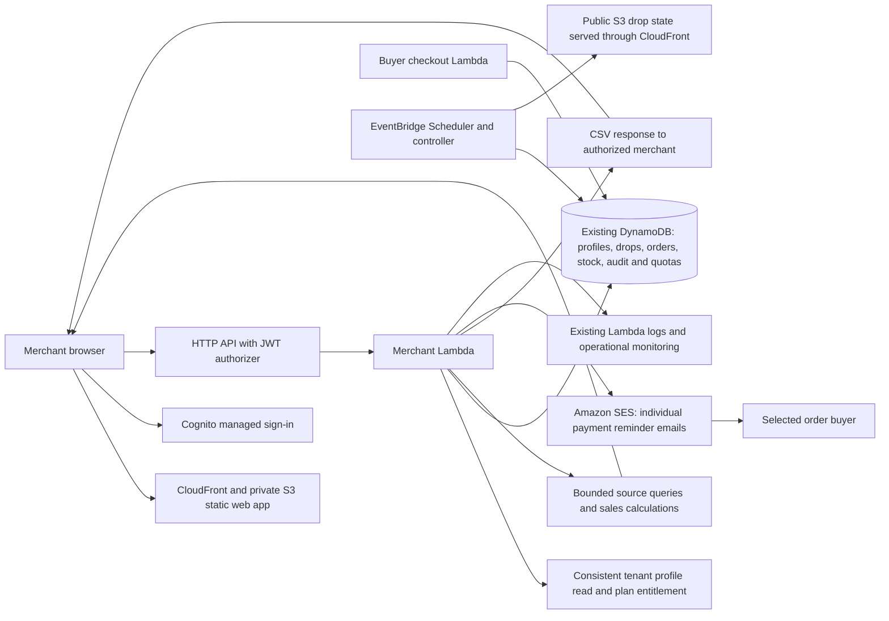

# Merchant dashboard: implementation, architecture and workflow

The merchant console is `/m/`; Analytics is `/m/?view=analytics`. This guide covers merchant workflows, architecture, configuration and operational limits.

## Implementation summary

The merchant console combines drop management, per-drop order reports and an Analytics workspace with Overview, Inventory, Payments and Pickup & delivery views. Growth merchants also receive an Advanced preview. Payments, pickups and deliveries are recorded manually by the merchant.

Reporting reads the existing tenant-owned DynamoDB orders on demand. The backend bounds the work and returns coverage information instead of maintaining a separate reporting pipeline. This implementation adds no analytics table, stream consumer, export queue or paid BI subscription. Its reports reflect retained source records and have the limits described below.

| Capability | Starter | Growth | Event |
| --- | --- | --- | --- |
| Basic daily sales chart and totals | Yes | Yes | Yes |
| Basic date range | Up to 31 days | Up to 31 days | Up to 31 days |
| Per-drop stock diagnostics and existing CSV export | Yes | Yes | Yes |
| Manual payment, pickup and shipping tracking | Yes | Yes | Yes |
| Individual and bulk payment reminder emails | With SES sender | With SES sender | With SES sender |
| Versioned changes and order history | Yes | Yes | Yes |
| Cross-drop comparison, variant ranking and calculated insights | No | Advanced preview | No |
| Advanced date range and previous-period comparison | No | Up to 90 days | No |
| Advanced daily-summary CSV | No | Complete selections only | No |
| Live QuickSight, Q&A or generative AI | Disabled | Disabled | Disabled |

The backend reads the merchant's current persisted tier consistently for every report/export request. An advanced request from Starter or Event is rejected; hiding a panel in the browser is not the access control. Unknown tiers receive basic access. Downgrades apply on the next request, including exports.

## Merchant workflow

### Shop and drops

A merchant signs in through Cognito and sets up the shop profile, branding, public slug, PayNow instructions and pickup/delivery note. The Drops view supports drafting, scheduling, unscheduling before the entry window, cancelling, duplicating, sharing and deleting drafts, subject to lifecycle and plan limits.

Scheduling writes stock shards, publishes public drop/state files and creates the controller schedule. The controller drives the drop lifecycle and public state. Merchant reports do not allocate or release inventory.

### Overview and sales results

Open Analytics, select a date range and optionally an individual drop. Dates use Singapore calendar boundaries and amounts use SGD. The Overview shows confirmed order value, recorded paid value, awaiting-payment value, average order value, daily sales bars and pickup/delivery counts. The chart has an expandable exact-value table.

Summary cards link to Payments or Pickup & delivery. When leaving Advanced with a range longer than 31 days, the date inputs switch to the latest 31 inclusive days ending on the selected To date, so basic reports and operational tabs remain available. Shorter ranges are preserved. Overview refreshes every 60 seconds while the page is visible; Refresh requests another snapshot and reloads the merchant profile. Failed refreshes display an error and identify any retained values as old.

All-drop reports cover up to 20 recent non-draft drops, with one query page of at most 500 orders per drop and four concurrent queries. Responses identify the number of covered drops and whether any page was truncated. A partial result is not a complete merchant-wide total. Selecting a drop narrows the scope but a large individual drop can still exceed the page limit.

### Inventory

Select Inventory and an individual drop. The page shows variant allocation; for a Live drop it also shows counter-based units held or confirmed, retained confirmed units and estimated available units. Live readings refresh every 15 seconds while visible. Missing/unprocessed stock shards or inconsistent counters make affected availability unknown. Confirmed-order reads are capped at 500 evaluated rows and truncation is identified. The full existing per-drop report remains accessible from this panel.

Inventory covers the whole selected drop, independent of the sales-date filter. Reservation counters include active holds and confirmed purchases and can include unreleased reservations. Reads can race with checkout. Closed drops show allocation and link to their order report rather than treating a leftover reservation counter as final sales. The page offers no stock-adjustment action.

### Payments

Select Payments and a drop, filter by awaiting, paid or unknown payment, and open an order. Record the payment status, method/reference, pickup/delivery details and a note, then save. These are the merchant's own records; DropDeck does not contact a bank, transfer funds or verify a PayNow receipt.

New and legacy orders retain their existing order reference. Legacy `paid` maps to recorded paid; legacy `confirmed` maps to awaiting; legacy `no-show` maps to unknown payment because the old single field cannot establish prior payment history. A no-show can be paid, so attendance is now tracked independently. The Drops overview, per-drop paid filters/counts and aggregate/per-variant report totals all use these independent fields: a paid no-show appears in both Paid and No-show, while an unknown payment is excluded from Awaiting. The overview projects only payment/attendance statuses, not tracking notes or buyer identity.

Reversing a paid status requires a reason in the Analytics editor. The older per-drop status route uses the same safe update function; a reversal requiring a reason must be performed in Analytics. The older report keeps its awaiting/no-show presentation while recognizing paid no-shows from the separate tracking fields.

### Payment reminders

In Payments, select a live or ended drop. Select individual awaiting-payment orders, or select up to 10 eligible orders on the current worklist page, then choose **Review reminders**. Opening an eligible order also offers **Review payment reminder**. The review panel lists each recipient and amount and lets the merchant preview each personalized email before choosing **Send reminders**. Selection is cleared on pagination, filter changes or refreshing orders; it never implicitly selects orders on other pages.

The fixed plain-text template includes only the buyer’s name, order reference, drop title, quantity/item, SGD amount and the shop’s saved PayNow instructions. Each SES request has exactly one recipient. Other buyers, merchant notes and shipping references are excluded. The platform’s configured, verified SES address sends on behalf of the shop; the buyer’s address is only the recipient. Merchants must save payment instructions before sending. The server reconstructs emails from tenant-owned records rather than accepting arbitrary recipients or message content from the browser.

The server rechecks current retained orders and rejects paid, unknown-payment, no-show, zero-value, invalid-address and cancelled/draft/scheduled-drop orders. A transaction checks the order/drop versions, reserves the per-order cooldown, creates an attempt audit and consumes the tenant’s daily allowance before sending. This closes conflicts before the send reservation; payment changes after that reservation can still race with an external email send. The template asks already-paid buyers to disregard the reminder and contact the shop for reconciliation.

Temporary DynamoDB transaction conflicts or throttling during reminder reservation are retried at most three times with bounded exponential backoff and jitter before any SES call. Condition failures (changed orders, cooldown or quota) are not retried. If contention persists, the result states that no email was sent and permits a fresh attempt; it is not classified as an ineligible order.

SES acceptance is displayed separately from inbox delivery. Results are returned per order, so partial success remains visible. A repeated request ID for the same order returns its recorded result without sending again. Successful, in-progress and uncertain attempts block another reminder for 24 hours. An explicit SES 4xx rejection (other than a request timeout) allows another attempt after one minute with a new request ID. SDK automatic retries and the OTP Resend fallback are disabled for reminders: a network timeout may mean SES already accepted the message. If saving the final result fails, the initial sending receipt remains a conservative cooldown lock. Operators investigate uncertain outcomes before retrying; the UI does not claim exactly-once inbox delivery.

Batches are synchronous, at most 10 orders with two sends in parallel, and capped at 100 attempts per shop per UTC day. These limits control accidental repeat mail, execution time and cost; they do not replace SES account sending quotas. A sandbox account can reject unverified recipients or throttle a batch. Sender verification and production access are region/account specific. [SES identity requirements](https://docs.aws.amazon.com/ses/latest/dg/verify-addresses-and-domains.html), [SES sandbox restrictions](https://docs.aws.amazon.com/ses/latest/dg/request-production-access.html).

The Payments worklist shows the latest attempt status/time, and order details show a bounded reminder audit history (up to 100 attempts, with a truncation warning). Audit records contain the actor, order reference, attempt time/outcome, cooldown and SES message ID when available; they do not copy email addresses or message bodies. Reminder records expire with the order, 180 days after drop end. The reminder feature does not change recorded payment, stock or pickup/delivery status.

Local demo mode explicitly labels this action **Simulate reminders** and never calls SES. Normal deployments expose sending only when core merchant analytics and `mailFrom` are configured. No sender means a visible unavailable explanation, rather than silently reporting a simulated send as successful.

### Pickup & delivery

Select Pickup & delivery and a drop, open an order and choose pickup or shipping. Pickup supports ready/collected; shipping supports ready/shipped/delivered. Unknown, not-started and exception states are available for unfinished or uncertain work. Carrier and tracking reference are required to record shipped or delivered. A merchant can record a known outcome directly; this is not an automated courier event feed.

Marking an unpaid order shipped, delivered or collected requires an explicit override reason. Reversing collected/delivered also requires a reason. An optional due time supports overdue counts. Dispatch and completion timestamps are recorded when those status transitions are saved.

No shipping address is collected by this feature. Merchants use their existing shipping arrangements and record the resulting carrier/reference. Recording payment, attendance, pickup or delivery does not refund money, return stock, generate a shipping label or send a buyer notification.

Payment and pickup/delivery worklists cover retained orders for the selected drop; they do not apply the sales-chart date filter. Each server page evaluates at most 50 orders before applying a status filter. An empty filtered page can have a next page. Cursors are bound to the authenticated tenant and drop. Refresh orders reloads the current page. Export this page downloads the displayed worklist rows and tracking fields without buyer names, emails or notes; references can still be sensitive data.

### Growth advanced preview

Growth sees the Advanced preview tab when enabled for the stage. It uses the same merchant-owned source data to show drop comparisons, variant rankings, selected-period totals, a previous-period comparison and calculated insight statements. Each comparison uses the same selected drops and the coverage warning applies to the whole result.

The preview is labelled **GROWTH · PREVIEW**, leads with sales insights and states that QuickSight is not connected. Charts and insights are rendered/calculated by DropDeck. There are no AWS embedding calls, natural-language requests, forecasts or AI-generated explanations. Natural-language questions are visibly unavailable. Starter/Event retain basic analysis and see a short explanation of the Growth preview.

Growth may export a complete advanced selection as a synchronous daily-summary CSV. It contains dates, order counts, confirmed amounts and recorded-paid amounts, without buyer identity. Partial selections and selections extending into expired history are rejected. The server permits two advanced exports per merchant per UTC hour. Existing per-drop order CSVs remain available through their existing route and now append the separate payment/fulfillment fields; these full exports include buyer details. Spreadsheet formulas are neutralized in text fields.

## Metrics and interpretation

| Metric | Meaning |
| --- | --- |
| Confirmed value | Sum of order amounts, including later no-shows; not cash collected |
| Recorded paid | Amount of orders currently marked paid by the merchant |
| Awaiting payment | Amount explicitly marked awaiting; unknown payments are separate |
| Average order | Confirmed value divided by order count; unavailable for zero orders |
| No-show units | Units on orders marked no-show, independently of payment |
| Awaiting pickup / delivery | Orders with a known unfinished fulfillment state |
| Unknown pickup / delivery | Orders whose fulfillment status has not been established |
| Past due | Unfinished orders whose merchant-entered due time has passed |
| Comparison sell-through | Ordered units in the selected sales period / the drop's full allocation; includes no-shows |

Daily charts group by `confirmedAt` for new orders. Legacy orders use `createdAt`, which historically represented reservation creation; the UI discloses this approximation. A payment change updates the paid amount for the order's original cohort, not a daily bank-receipts chart. Previous-period percentage change is unavailable without a nonzero baseline. Variants remain distinct by drop and variant ID, even when names match.

Results cover retained records only. Order expiry can make older totals incomplete. There is no persistent 13-month analytics archive, profit calculation, demand forecast or warehouse-wide inventory ledger in this implementation. Existing monthly billing usage is a separate dataset and is not changed by these reports.

## Architecture and AWS services

| Service | Implementation and rationale |
| --- | --- |
| CloudFront + S3 | Existing static console delivery; private API reports use `Cache-Control: no-store` and are not published as public shop JSON |
| Cognito + API Gateway HTTP API | Existing JWT authentication protects all analytics, tracking and history routes; tenant identity comes from verified `sub` |
| Merchant Lambda | Validates entitlements, performs bounded reads and calculates charts; reuses the existing function rather than adding always-on compute |
| DynamoDB on-demand | Existing tenant-prefixed source data; transactions atomically save order tracking and an audit receipt; on-demand billing follows activity |
| Amazon SES | Reuses the stage’s verified sender for transactional reminders. IAM restricts the merchant function to the sender identity/domain and exact From address. Reminders do not use the checkout OTP configuration set, so they cannot inflate OTP delivery metrics. Per-order outcomes are stored in DynamoDB; this feature does not add a reminder delivery-event pipeline |
| EventBridge Scheduler/controller | Existing drop scheduling and lifecycle; not an analytics aggregation scheduler |
| CloudWatch | Existing function logs and optional operational monitoring; no per-merchant custom metric series is added by analytics |
| AWS Budgets | Existing account budget sends actual-spend alerts when its configured email is present; alerts are delayed notifications, not a hard spending cap |
| Amazon QuickSight | Intended managed BI service represented by the Growth preview; no subscription, users, datasets, permissions or infrastructure are provisioned |

Analytics uses no DynamoDB Streams consumer, separate analytics database, SQS export worker, S3 export archive, Athena query or Bedrock invocation. Advanced analytics runs within DropDeck without provisioning paid BI resources. Checkout SES delivery and operations monitoring have separate configuration. Reminder sends share the account’s SES quota and add usage-based email charges.

## Data integrity, history and retention

Orders add optional `confirmedAt`, `version` and `tracking`. Tracking contains independent payment, attendance, fulfillment method/status, optional payment/carrier references, due time, timestamps and a merchant note. Existing rows are normalized on read; no invented historical payment or shipping timestamps are backfilled.

Tracking writes require an expected version and request ID. A DynamoDB transaction replaces the version-matched order and creates an audit receipt under the same tenant partition. Repeating an identical request returns the existing result without duplicating history. Reusing an ID for another action or submitting an obsolete version returns a conflict. The browser must refresh a conflicting order before saving again.

Audit rows record the actor, time, previous/new tracking, reason, version and an idempotency hash. History returns at most 100 records, sorted by version within the returned page, and flags truncation. It is an application audit trail, not a tamper-proof financial ledger. Names/emails are not copied into audit entries, but tracking references and notes can still be personal data.

Checkout order creation uses a conditional insert. A retry for an already-created order cannot replace tracking recorded later by the merchant. Tracking changes never write the stock shards.

Orders and audit entries use the same expiry: 180 days after drop end. Analytics, worklist, history, inventory-order counts and existing per-drop order/report/export reads check logical expiry even before DynamoDB TTL physically deletes rows. The existing tenant-deletion CLI deletes the tenant partition, which also removes these audit and quota rows. Exported files are retained under the merchant's own policy. The existing per-drop report/export paths otherwise retain their pre-existing full-pagination behavior.

## API surface and configuration

| Route | Function |
| --- | --- |
| `GET /m/analytics` | Basic report; `advanced=1` requires Growth and the preview setting |
| `GET /m/analytics/export.csv` | Growth-only, complete daily-summary export; export quota applies |
| `POST /m/payment-reminders` | Authenticated manual send; body includes drop ID, 1–10 unique order references and request ID; returns per-order outcomes |
| `GET /m/order-worklist` | Drop-scoped, paginated payment/fulfillment worklist |
| `GET /m/drops/{dropId}/inventory` | Bounded stock-shard and confirmed-order diagnostic snapshot |
| `PATCH /m/orders/{ref}/tracking` | Versioned manual action; body includes drop ID, request ID, expected version and tracking patch |
| `GET /m/orders/{ref}/history` | Tenant-owned retained tracking and reminder history; query includes drop ID |

The existing profile, drop lifecycle, order, live, report, usage and per-drop CSV routes remain in place.

CDK stage settings `merchantAnalyticsEnabled` and `growthAnalyticsPreviewEnabled` independently configure core analytics and Growth preview exposure. Staging enables both; new stages default off. Core analytics does not depend on `operationsEnabled`. QuickSight remains disconnected in the capability response and has no provisioning or service-call path. Enabling the Growth preview never activates a QuickSight subscription.

## Cost management and operational limits

- Reuse the stage’s SES sender for payment reminders; no new email worker, queue or subscription. Limit batches to 10, use two concurrent sends, enforce a 24-hour order cooldown and a 100-attempt UTC-day tenant quota. Failed attempts also consume quota. Reminder audit/latest rows expire with the order, and quota rows expire after two days. The merchant function timeout is 28 seconds; SES connection/request timeouts and disabled SDK retries bound individual send attempts. Account-wide SES throttling still applies, including competition with checkout emails.
- Reuse the existing function/table and static hosting. This feature adds usage and retained audit storage, but no additional always-on resource or BI subscription.
- Limit source work to 20 drops × 500 evaluated orders, four concurrent queries, a 31-day basic range or 90-day advanced range. Display partial results explicitly rather than running an unbounded table scan.
- Permit up to 30 analytics requests per merchant per UTC minute; enforce this with a tenant quota row. Quota rows expire after an hour. Advanced exports have a separate two-per-hour quota expiring after one day.
- Refresh sales once per minute and a viewed Live inventory panel every 15 seconds. Stop automatic refresh in background tabs. The new inventory endpoint bounds order reads and explicitly identifies incomplete shard results.
- Use one bounded synchronous summary CSV response. It creates no export bucket, queue, worker or download-link lifecycle.
- Avoid per-tenant CloudWatch metric dimensions and log payloads containing orders, tracking notes or buyer contact details. Existing monitoring resources and metric/alarm charges remain part of the platform bill.

Costs depend mainly on source bytes read, refresh frequency, Lambda duration and audit writes. At Singapore on-demand rates checked on 18 October 2026, strongly consistent reads consume one read unit per rounded 4 KB of queried data, DynamoDB reads cost $0.1425/million units and writes $0.71/million units; transactional writes consume twice the ordinary write units. Query limits count evaluated rows, and projection/filter expressions do not make source reads free. [DynamoDB pricing](https://aws.amazon.com/dynamodb/pricing/), [Singapore price list](https://pricing.us-east-1.amazonaws.com/offers/v1.0/aws/AmazonDynamoDB/current/ap-southeast-1/index.json).

For scale context, 100,000 maximum-size reports reading 20 × 500 one-KB order rows would consume roughly 250 million read units, or **$35.63 in reads alone**, before profile/quota requests, compute and other charges. Typical smaller drop reports cost much less. Measure request volume, consumed capacity and duration under the team's actual workload before increasing limits. Existing budget alerts can arrive after charges have accrued. [AWS Budgets behavior](https://docs.aws.amazon.com/cost-management/latest/userguide/budgets-managing-costs.html).

QuickSight Author/Reader, session capacity and Q/Pro charges are excluded because that service is not activated. [QuickSight pricing](https://aws.amazon.com/quick/quicksight/pricing/).

## Verification and deployment boundary

Reminder tests cover per-buyer templates, replay/concurrency protection, payment changes, tenant isolation, logical expiry, cancellation, sender configuration, daily limits, transient reservation retries/exhaustion, non-retryable condition failures, partial SES failure, uncertain sends and final-receipt write failure against DynamoDB Local with a mocked mail transport. They send no real email. Infrastructure assertions check reminder JWT authentication and sender-scoped SES permissions.

Integration coverage includes persisted plan enforcement/downgrades, malformed dates, request replay, concurrent edits, required reversal/override reasons, shipping validation, tenant/cursor isolation, logical expiry, partial report/export behavior, export quotas and checkout retry preservation. Infrastructure assertions verify JWT-protected routes, enabled capability flags and absence of QuickSight resources/permissions. Production export checks exclude local fixture/authentication shortcuts.

Local demo mode exercises UI with browser-local test data. The Growth advanced preview in a normal AWS deployment uses authenticated backend data. A preview label does not switch a deployment into demo mode. Live AWS smoke checks and cost measurements happen after deployment; local tests alone do not establish deployed behavior.
